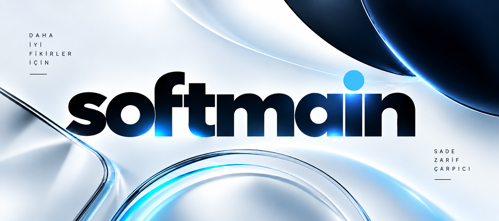

 

  

 

---

## 👋 Hakkımda

- 🎓 **İstanbul Zaim Üniversitesi**, Bilgisayar Mühendisliği öğrencisiyim
- 💻 C/C++ alanında geliştirdiğim kodları burada paylaşıyorum
- 🌐 **Softmain** ile web çözümleri geliştiriyorum
- 🔍 Wireshark ile ağ trafiği analizi yapıyorum

## 🛠️ Yetenekler

  

| Alan | Teknolojiler |
|------|--------------|
| **Diller** | C, C++, Python |
| **IDE / Editör** | VS Code, CLion, PyCharm |
| **Backend / Veritabanı** | Supabase |
| **Ağ Analizi** | Wireshark |
| **Araçlar** | Git, GitHub |

## 🚀 Projelerim

<table>
  <tr>
    <td width="50%" valign="top">
      <h3>🏠 Smart Home</h3>
      
Telefon ve PC'den kontrol edilen, 3D ev modeline sahip akıllı ev kontrol uygulaması.

      
    </td>
    <td width="50%" valign="top">
      <h3>📱 Mobile App</h3>
      
Aynı mekanda bulunan insanları buluşturan konum tabanlı sosyal mobil uygulama.

      
    </td>
  </tr>
</table>

## 📊 GitHub İstatistikleri

  

## 📫 İletişim

  
  

